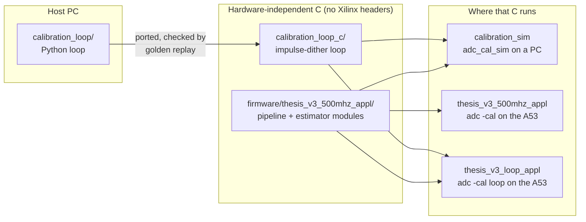
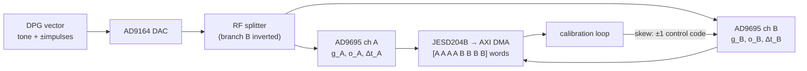
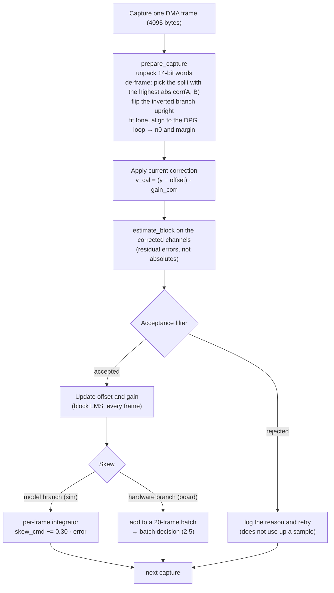
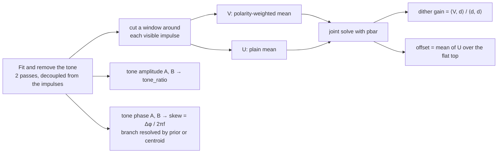
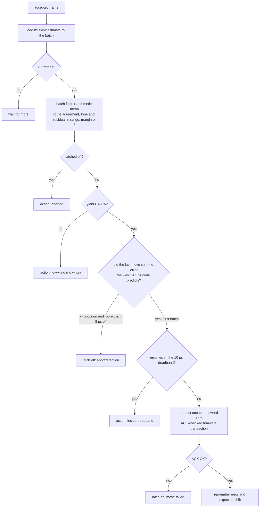
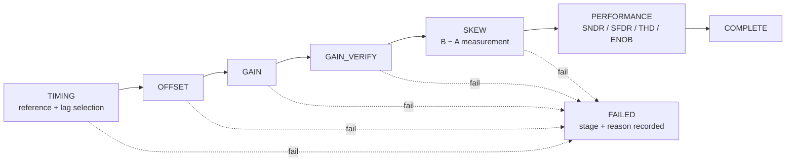
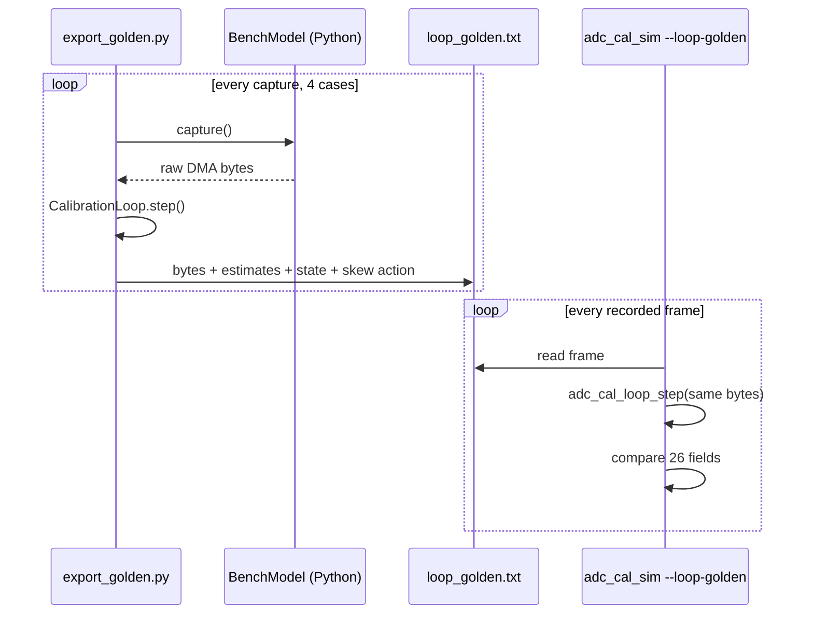
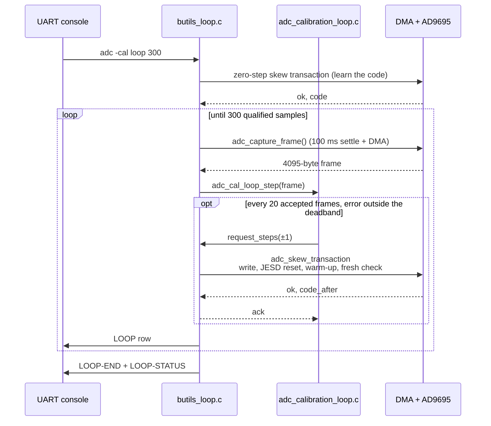

# ADC Calibration Desktop Simulation

`calibration_sim` is a desktop C test harness for the ADC calibration code.
It compiles the production calibration modules on a PC and drives them with
synthetic or recorded captures. It runs on Linux or WSL and needs no FPGA, Vitis,
Xilinx BSP, DMA, SPI, UART, JESD or Ethernet hardware.

**Quick start**

```sh
cd calibration_sim
cmake -S . -B build && cmake --build build
./build/adc_cal_sim --run-all          # exit code 0 only if everything passes
```

## Contents

1. [The big picture](#1-the-big-picture)
2. [What the calibration loop does](#2-what-the-calibration-loop-does)
3. [The firmware's staged pipeline (`adc -cal`)](#3-the-firmwares-staged-pipeline-adc--cal)
4. [Build and run](#4-build-and-run)
5. [What the simulator covers](#5-what-the-simulator-covers)
6. [Outputs and failures](#6-outputs-and-failures)
7. [On-board loop firmware (`thesis_v3_loop_appl`)](#7-on-board-loop-firmware-thesis_v3_loop_appl)

---

## 1. The big picture

The repository contains **two calibration algorithms**, and this simulator tests both:

| | Impulse-dither loop | Staged pipeline |
|---|---|---|
| What it is | Closed loop: one capture → one correction update, repeated | Fail-fast sequence of stages: timing → offset → gain → skew → performance |
| Reference code | `calibration_loop/` (Python, host) | `firmware/thesis_v3_500mhz_appl/` (C) |
| C code tested here | `calibration_loop_c/adc_calibration_loop.c` | `adc_calibration_pipeline.c` and the estimator modules |
| Runs on the board as | `adc -cal loop` in `thesis_v3_loop_appl` | `adc -cal` in `thesis_v3_500mhz_appl` |
| Bench status | The Python loop is the one used in recent bench sessions | Older flow |



Because the same C files are compiled into the firmware and into this simulator,
a test that passes here exercises the production code path. The hardware it
cannot exercise is listed in [What is not simulated](#what-is-not-simulated).

---

## 2. What the calibration loop does

### 2.1 The problem

The AD9695 has two converters, A and B. They are fed from one RF splitter and
sample the **same instant**. They are parallel, not yet interleaved. Each one
deviates slightly from ideal:

| Mismatch | Model | What it does to A − B |
|---|---|---|
| Gain | `g_B ≠ g_A` | the tone appears in A − B scaled by the gain difference |
| Offset | `o_B ≠ o_A` | a DC step between the channels |
| Timing skew | `t_B ≠ t_A` | the tone appears in A − B with amplitude `2·sin(π·f·Δt)` |

Per channel: `y[n] = g · x(t_n + Δt) + o + noise`. The loop estimates the three
mismatches from the data and drives them to zero:

- **gain and offset** with a digital correction,
  `y_cal = (y − offset) · gain_corr`;
- **skew** through the AD9695 sample-clock delay, one control code at a time.



### 2.2 The excitation: a tone plus balanced ±1 impulses

The DPG plays a coherent tone (199.375 MHz) plus a short flat-topped impulse in
every 130-sample slot. Each impulse has a pseudo-random polarity `p[k] = ±1`, with
exactly as many +1 as −1 over the loop. The impulse shape is known, so different
parts of it carry different information:

| Part of the impulse | Slope | Carries |
|---|---|---|
| Flat top | `dx/dt = 0` | gain and offset only, insensitive to timing |
| Edges | maximal, known | timing |
| Tone (whole record) | — | gain (`tone_ratio`) and timing (tone phase), ~10× quieter than the impulses on the bench |

After the tone is fitted and removed, the windows around the visible impulses are
averaged twice:

```
V[m] = mean_k  p[k] · r[n_k + m]   →  impulse amplitude   (offset and tone cancel)
U[m] = mean_k         r[n_k + m]   →  offset              (impulses cancel, sum p = 0)
```

A capture only sees ~8 impulses, so their polarities do not sum to exactly zero.
`V` and `U` are therefore solved jointly using the observed mean polarity `pbar`.

### 2.3 One iteration



The estimate is taken **after** the current correction has been applied. Each
estimate is therefore a residual error, and the recorded trajectory is a genuine
closed-loop learning curve, not a series of independent one-shot measurements.

Inside `estimate_block`:



### 2.4 How each axis is corrected

| Axis | Observable | Applied where | Update per accepted frame |
|---|---|---|---|
| Offset | flat-top mean of `U`, per channel | digital, `offset_x` | `offset_x += 0.35 · e_x / gain_corr_x` |
| Gain | **tone amplitude** ratio `abs(B) / abs(A)` (falls back to the dither ratio) | digital, `gain_corr_x` | both channels pulled 35 % of the way to their common mean |
| Skew | tone-phase difference, ps | AD9695 clock delay | model: per-frame integrator, μ = 0.30; hardware: batch decision below |

The gain loop deliberately nulls the **tone** ratio, since the tone is what the A−B
spur at f_in is made of. `g_B/g_A` from the dither windows therefore settles near
1.012 by design.

### 2.5 The skew batch decision (hardware branch)

One control code moves the skew by more than the residual error near convergence:
~19 ps/code at the working point, ~7 ps/code near neutral. A per-frame integrator
would therefore chase its own noise. Instead, the loop decides once per batch:



A latch stops only the skew actuation. The digital gain and offset loop keeps
running, because it writes no hardware.

### 2.6 Acceptance filter and sample accounting

A frame is rejected, and logged, when any of these holds:

| Reason | Threshold |
|---|---|
| Alignment margin | `< 6` (torn or stale frames show up here) |
| Too few impulses | `< 2` complete events in either channel |
| Estimate not finite | gain or skew of channel A or B |
| Skew out of range | `abs(residual) > 0.25` samples (192 ps) |
| Gain out of range | `abs(ratio − 1) > 0.20` |

`run(N)` collects **N qualified samples**, so rejected frames are retried and do not
count. A run stops early after 20 consecutive rejects (the bench has stopped
producing usable data) or 3 consecutive capture failures.

---

## 3. The firmware's staged pipeline (`adc -cal`)

The production pipeline in `adc_calibration_pipeline.c` is a different algorithm
from the impulse-dither loop. It is a fail-fast sequencer driven by an uploaded
DAC reference (`adc -ref`). The simulator tests it through its unit, scenario and
pipeline suites.



Its correction convention is `final_code = round(gain · (raw + offset))`, which is
**not** the loop's `(y − offset) · gain_corr`. Do not unify the two casually.

---

## 4. Build and run

### Build

```sh
cd calibration_sim
cmake -S . -B build
cmake --build build

# optional: AddressSanitizer + UBSan
cmake -S . -B build-asan -DADC_CAL_ENABLE_SANITIZERS=ON
cmake --build build-asan
```

### Run

| Command | Runs |
|---|---|
| `--run-all` | everything below except stress and golden replay |
| `--run-unit-tests` | unit tests of production APIs (the default when no option is given) |
| `--run-controller-tests` | synthetic closed-loop controller tests |
| `--scenario NAME` | one scenario |
| `--run-pipeline NAME` | one shared-sequencer integration case |
| `--run-all-pipeline-scenarios` | every pipeline case |
| `--run-loop-tests` | `calibration_loop_c` against a C twin of `BenchModel` |
| `--loop-golden FILE` | replay a Python golden file through the C loop |
| `--stress-seeds N` | stochastic seeds 1..N, continues past failures |
| `--list-scenarios`, `--help` | listings |
| `--seed N`, `--output-dir DIR` | modifiers |

The process exits with `0` only when every selected test and scenario expectation
passes.

---

## 5. What the simulator covers

### What it compiles

| Module | Role |
|---|---|
| `adc_frame.c` | DMA bytes → channels |
| `adc_calibration_pipeline.c` | staged sequencer |
| `adc_calibration_dither.c`, `adc_calibration_skew.c`, `adc_calibration_performance.c` | pipeline estimators |
| `calibration.c`, `timing_alignment.c`, `reference_buffer.c` | offset/gain loop, lag alignment, reference upload |
| `../calibration_loop_c/adc_calibration_loop.c` | impulse-dither loop |

`butils.c` and `butils_calibration.c` are not compiled here. They contain Xilinx BSP
interfaces, board orchestration, printing and register writes. The simulator only
provides the two invalidation hooks from `calibration_pending.h`.

### What is simulated

- Synthetic DAC-rate and ADC-rate reference generation.
- Parallel, same-instant Channel A and Channel B captures.
- Offset, gain, delay/skew, noise, drift, clipping, harmonic and spur injection.
- The firmware DMA byte layout: `w0..w3` are Channel A samples and `w4..w7` are
  Channel B samples, as signed 14-bit values left-aligned in `int16_t`.
- Unit tests of reconstruction, timing, calibration, reference upload, correction
  sign, the dither/skew/performance estimators, boundary behaviour and the
  invalidation-hook wiring.
- Controller-style synthetic loops using the production calibration APIs.
- The impulse-dither loop against a bench model, including a closed skew loop and
  the batch decision with an honest and a lying actuator.

The end-to-end deterministic replay uses the exact DAC reference
`sine_100MHz_2p6GSPS_impulse_dither.txt` and the DMA capture
`adc_capture_20260801_180451.csv`. It advances the pipeline through all five
stages. The recorded frame is replayed for every requested frame, so it validates
the software path without pretending to contain independent noise realisations.

The bin-71 capture `adc_capture_20260805_100121.csv` is kept as an explicit test
of the rate-matching estimator. Production rejects a 1.45 GSPS waveform when the
ADC is configured for 1.30 GSPS, and accepts matching 1.30/2.60 GSPS metadata.

### What is not simulated

JESD transport ordering, DMA hardware state, cache coherency, analog clock jitter,
real ADC noise, SPI register behaviour, and the hardware skew registers. The
pipeline's skew stage is open-loop characterisation only. The channels are parallel
captures, never an interleaved stream, matching the current FPGA.

### Coverage matrix

| Component | Host coverage | FPGA validation |
| --- | --- | --- |
| automatic stage sequencer | Direct | Built |
| production dither estimator | Direct | Built |
| production skew estimator | Direct | Built |
| production performance analysis | Direct | Built |
| production performance batch | Direct | Built |
| impulse-dither loop (`calibration_loop_c`) | Direct + golden replay against Python | Built in `thesis_v3_loop_appl`, not yet run |
| FPGA adapters to shared estimators | Source inspected | Built |
| UART parser | Not host tested | Not tested |
| DMA/JESD/cache | Not host tested | Not tested |
| SPI/register behavior | Not host tested | Not tested |
| analog hardware | Synthetic only | Not tested |

The pipeline flow tests the same sequencer the FPGA `adc -cal` adapter uses. It is
not a board validation of the `butils_calibration.c` adapters, the UART formatting
or the hardware side effects. Direct `calibration.c` tests use that module's
documented model `corrected = raw * gain + offset`. The pipeline performance
captures mirror the integrated convention `round(gain * (raw + offset))`.

### Scenarios (`--scenario`, `--run-all`)

| Scenario | What it injects |
|---|---|
| `nominal` | small offset, small gain error, zero relative skew, moderate noise |
| `timing_shift` | frame-to-frame integer shifts plus fractional delay |
| `noisy` | noisy captures with periodic low-correlation frames |
| `bad_reference` | reference/tone mismatch that must fail cleanly |
| `offset_positive`, `offset_negative` | ADC offset of either sign |
| `gain_low`, `gain_high` | ADC gain below / above nominal |
| `gain_saturation` | required correction beyond the supported range |
| `skew_positive`, `skew_negative` | Channel B delayed / advanced relative to A |
| `skew_outside_range` | relative skew beyond the linear range |
| `insufficient_dither` | too few complete dither events |
| `clipped_input` | clipped captures |
| `performance_noise` | high noise: lower SNDR/ENOB than nominal |
| `performance_harmonic` | harmonic distortion: worse THD |
| `performance_spur` | added spur: worse SFDR |
| `invalidation` | host invalidation-hook wiring only, not the `butils.c` state |

Classification:

| Kind | Members |
|---|---|
| Production-function tests | unit tests of `adc_reconstruct_channels()`, `adc_reconstruct_frame()`, lag / fractional lag, `calibration_analyze_frame()`, `calibration_update()`, `calibration_process_frame()`, correction setters, reference upload/finalize, `adc_cal_dither_analyze()`, `adc_cal_skew_estimate_from_residuals()`, `adc_cal_perf_run_batch()` |
| Simulator-model tests on production primitives | `nominal`, `timing_shift`, `noisy`, `offset_*`, `gain_low`, `gain_high`, `gain_saturation`, `performance_*` |
| Placeholder / simplified | `bad_reference` (synthetic gate), `clipped_input` (not every rejection path), `invalidation` (hook wiring only) |

### Pipeline scenarios (`--run-all-pipeline-scenarios`)

`nominal`, `timing_shift`, `noisy`, `gain_saturation`, `skew_positive`,
`skew_negative`, `performance_distortion`, `timing_failure`,
`offset_nonconvergence`, `gain_verification_failure`, `insufficient_dither`,
`performance_invalid`, `invalidation_after_complete`, `standalone_sequence`.

These cases test the following directly against `adc_calibration_pipeline.c`:
stage sequencing, fail-fast behaviour, the performance NOT RUN invalidation, and
standalone command ordering. The callback bodies differ by stage:

- Timing and offset/gain use the production `timing_alignment.c` and
  `calibration.c`.
- Skew synthesises residuals, then calls `adc_cal_skew_estimate_from_residuals()`.
- Performance synthesises captures, then calls `adc_cal_perf_run_batch()`.

### Loop tests (`--run-loop-tests`, `--loop-golden`)

Native tests (no input files):

- config validation, pulse shape, tone fit, de-framing;
- a closed loop on a C twin of `BenchModel`, which must converge on gain, offset
  and skew;
- the batch decision: an honest actuator walks into the deadband, and a lying one
  latches after exactly one move;
- a reject streak, which must stop the run after 20 captures.

The golden replay compares the C loop with the Python loop on identical bytes:



```sh
python ../calibration_loop_c/export_golden.py     # needs numpy; writes output/loop_golden.txt
./build/adc_cal_sim --loop-golden output/loop_golden.txt
```

Integers must match exactly and floats to a relative 1e-6. The last result was a
max relative deviation of 9.3e-10 over 140 frames. See `../calibration_loop_c/README.md`,
including the inherited `n0` tie.

---

## 6. Outputs and failures

| File (in `output/`) | Contents |
|---|---|
| `test_summary.txt` | every assertion and the counts; **start here** |
| `unit_test_results.csv` | unit test rows |
| `calibration_iterations.csv` | rejection reasons and coefficient movement |
| `performance.csv` | wide per-frame metrics, comparable with board-side output |
| `stress_summary.csv` | seed, scenario, pass/fail, measured value, expected range, failure reason |

- **Spectral regressions.** Compare `performance.csv` across scenarios or seeds.
  Performance tests check monotonic relationships, not exact SNDR/ENOB/SFDR/THD
  numbers.
- **Boundary tests.** These record hard pass/fail checks plus `KNOWN_GAP` rows for
  robustness issues that need production changes. Do not convert a `KNOWN_GAP`
  into a pass. Every floating-point `calibration_config_t` field is covered with
  NaN and ±Inf. The remaining gap is forcing the reference generation counter
  through wraparound, which needs a production test seam.
- **Adding a scenario.** Add the name to `k_scenarios` in `sim_tests.c` and its
  signal configuration in `sim_signal_configure_scenario()`. Keep it deterministic
  through `random_seed`.
- **Stress mode.** `--stress-seeds N` runs the stochastic scenarios for seeds
  1..N and continues after failures, so every result is written.

---

## 7. On-board loop firmware (`thesis_v3_loop_appl`)

Vitis application that runs the impulse-dither loop **on the Cortex-A53** instead
of the host. It is the firmware of `firmware/thesis_v3_500mhz_appl/` plus
`calibration_loop_c` and one console command, `adc -cal loop`. Paths are relative
to the repository root, except those quoted from `src/UserConfig.cmake`, which are
relative to `firmware/thesis_v3_loop_appl/src/`.

> **Status (2026-10-08).** The component exists. It was created in Vitis 2025.2 on
> `final_ver_1`. It compiles and links with the Vitis 2025.2 `aarch64-none-elf-gcc`
> 13.3, checked by hand outside the IDE; the only warning is the existing
> `SET_BIT` redefinition in `ethernet.c`. It has **not** been built in the IDE or
> run on the board yet. `thesis_v3_500mhz_appl` is untouched.
>
> **Platform version.** The lab uses Vitis 2025.1. `final_ver_1` was regenerated in
> 2025.2, because the 2025.2 app template calls `print_build_info_target`, which
> the 2025.1 export lacks. This changed many tracked BSP files. Do not push them to
> `main` without agreeing on a version. `git checkout -- firmware/final_ver_1`
> restores the 2025.1 platform.

### Host loop vs on-board loop

| | `thesis_v3_500mhz_appl` + Python | `thesis_v3_loop_appl` |
|---|---|---|
| Who runs the loop | host PC, one UART/UDP round trip per capture | the board, inside one `adc -cal loop N` |
| Data path | `dma -d` → `dma -w` → `udp` → PC | `adc_capture_frame()` → `RxBufferPtr`, no network |
| Skew write | host sends `adc -cal skew step ±1`, parses `SKEW-TXN ... result=OK` | loop calls the same transaction and reads its status struct |
| Everything else | — | unchanged; `adc -cal skew step` prints the same lines, so `tools/skew_park.py` still works |



### Files

```
firmware/thesis_v3_loop_appl/
├── butils.c          copy of thesis_v3_500mhz_appl/butils.c with five edits:
│                       header note · adc_skew_txn_result_t + prototypes ·
│                       "adc -cal loop" dispatch · help line ·
│                       skew transaction split into adc_skew_transaction() (status, no
│                       printing) + handle_adc_skew_transaction_cmd() (same SKEW-TXN output) ·
│                       #define BUTILS_LOOP_FRAGMENT + #include "butils_loop.c" at the end
├── butils_loop.c     board adapter, #included by butils.c like butils_calibration.c
├── loop_waveform.h   config of the vector on the DPG
├── vitis-comp.json, _ide/              Vitis-generated
└── src/
    ├── CMakeLists.txt, app.yaml, ...   Vitis-generated, untouched
    ├── UserConfig.cmake                edited: sources, include dirs, -lm, -O2 for the loop
    └── lscript.ld                      edited: _STACK_SIZE 0x2000 → 0x10000
```

- **Why `butils_loop.c` is `#include`d.** `butils.c` already pulls in
  `butils_calibration.c` as one translation unit, and the adapter needs functions
  that are `static` there.
- **Vitis adds sources by itself.** It adds every `.c` in the component folder to
  `USER_COMPILE_SOURCES` (it added `../butils.c` that way). The
  `BUTILS_LOOP_FRAGMENT` guard makes a stray standalone compile of
  `butils_loop.c` empty instead of duplicate.
- **Why the two edits under `src/` are deliberate.** `UserConfig.cmake` is the
  template's user-settings file. `lscript.ld` gets the original app's stack: its
  comment explains that the calibration code otherwise corrupts its return
  context and restarts the processor, and the Vitis default of 8 KB is too small.

| `src/UserConfig.cmake` | Value |
|---|---|
| `USER_COMPILE_SOURCES` | the 16 unchanged sources referenced from `../../thesis_v3_500mhz_appl/` (not copied, so fixes there apply here), `../butils.c`, `../../../calibration_loop_c/adc_calibration_loop.c` |
| `USER_INCLUDE_DIRECTORIES` | `..`, `../../thesis_v3_500mhz_appl`, `../../../calibration_loop_c` |
| `USER_LINK_LIBRARIES` | `m` (the 2025.2 template no longer links libm) |
| `set_source_files_properties(...)` | `-O2` for the loop only; everything else stays `-O0 -g3` like the original |

### Commands

```
adc -cal loop N        N qualified samples: gain/offset per frame, skew batch decision
adc -cal loop open N   same, skew measured only (no actuator writes)
adc -cal loop status   state of the last run
adc -cal loop [help]   usage and the waveform the loop assumes
```

- N is 1..2000, and every run starts from a fresh state.
- After a bring-up, run `adc -cal skew step 0` first.
- A closed run learns the actuator code from a zero-step ACK and refuses to start
  if that transaction fails. An open run only reads the code over SPI.
- Every iteration costs at least the 100 ms settle in `adc_capture_frame()` plus
  the compute time. A skew move adds one warm-up capture.

| Hook in `butils_loop.c` | Implementation |
|---|---|
| capture | `adc_capture_frame()`, then the generation must have advanced, then copy `RxBufferPtr`. 4095 bytes = 2047 words, and the odd byte is dropped as on the host. |
| `request_steps(delta)` | `adc_skew_transaction(delta)`. Any `RECOVERY_REQUIRED` stage gives `ok = 0` and latches skew off. Prints a `LOOP-SKEW-TXN` line. |
| state | `static adc_cal_loop_t g_board_loop`, ~570 KB in `.bss` (DDR), never on the 64 KB stack |
| config | `loop_waveform.h`: `w06adc_e04_t04_amp5190_tone_m1p5` = host defaults with edge 4 / top 4 DAC samples and 5190 LSB, polarity seed 20260725. It must match the DPG, or the margin collapses and the run stops after 20 rejects. |

### Output

`xil_printf` has no floating point and no `%+d`, so values are scaled integers,
or `nan` when not finite.

```
LOOP-START mode=closed samples=300 waveform=w06adc_e04_t04_amp5190_tone_m1p5 code=24
LOOP it= st=<ok|margin|events|a_nan|b_nan|skew_range|gain_range|capture> n0= rot= margin_x100=
     tone_ppm= gain_ppm= doff_mc= skew_cps= corr_a_ppm= corr_b_ppm= offa_mc= offb_mc=
     [batch=<used>/<frames> bmean_cps= act=<action>[±1] code=]     on a batch decision only
LOOP-SKEW-TXN steps=+1 result=OK code_before=24 code_after=25 stage=-
LOOP-END qualified= captures= rejected= code= skew_abort= elapsed_ms= compute_ms_avg=
```

| Field | Meaning |
|---|---|
| `tone_ppm` | `(tone_ratio − 1)·1e6`: the controlled gain observable, goes to 0 |
| `gain_ppm` | `(g_B/g_A − 1)·1e6`: the dither route, settles near +12000 by design |
| `doff_mc` | `(offset_B − offset_A)·1e3` codes |
| `skew_cps` | skew in 0.01 ps |
| `corr_*_ppm`, `off*_mc` | applied gain correction − 1 (ppm), state offsets × 1e3 |

### Creating the component in Vitis 2025.2: the traps

| Symptom | Cause | Fix |
|---|---|---|
| "Invalid Template 'empty_application'" (lopper fails) | Smart App Control blocks `cc1.exe` loading `libisl-23.dll` (Code Integrity events 3033/3077) | allow the Vitis tools |
| "location contains spaces" | a space in the component name field | retype the name |
| `Unknown CMake command "print_build_info_target"` | 2025.2 app template on a 2025.1 platform | Regenerate BSP + Build `final_ver_1` in 2025.2 |
| "opening dependency file ... No such file or directory" | object paths over the 260-character MAX_PATH (264 for a platform named `final_ver_1_v2025_2`); the MinGW gcc ignores `LongPathsEnabled` | keep platform names short (`final_ver_1` builds) |

The app itself: `File → New Component → Application`, name `thesis_v3_loop_appl`,
location `firmware/`, platform `final_ver_1`, domain `standalone_psu_cortexa53_0`,
Empty Application (C), no sources.

### Bench verification

1. Build `thesis_v3_loop_appl` in Vitis and load it. Then bring-up, load the
   tone+dither vector, and run `adc -cal skew step 0`.
2. **Transaction refactor.** `adc -cal skew step +1`, then `-1`. Both must print
   `SKEW-TXN ... result=OK`, as on the original ELF.
3. **Open loop.** `adc -cal loop open 20`. Expect `st=ok` rows and
   `margin_x100 > 600`, and record `compute_ms_avg`.
4. **Matched pair against the host.**
   1. `python tools/skew_park.py --uart COM5 --code 24`.
   2. Host run: `python -m calibration_loop.run_calibration bench --uart COM5 --allow-skew-writes --iterations 300`.
   3. Park at code 24 again.
   4. `adc -cal loop 300` on this ELF.
   5. Compare. Expect the same moves and codes in the same batches, `tone_ppm` → 0,
      a signed offset residual of ~0.1 codes, and a final skew inside the 10 ps
      deadband.

### Constraints

- Every skew write resets the JESD link. Only the transaction may write the
  actuator, since it includes the warm-up capture and the freshness check.
- The loop's corrections live only in `g_board_loop.state`. They are not applied to
  `RxBufferPtr` or to any other `adc -cal` stage.
- Only the tone route is ported. A dither-only vector needs `dither_raw.py`, which
  is not ported, and every frame on it would be rejected.
- Do not commit the ELF or build outputs.

### Open items

- [x] Vitis component, `butils.c` refactor, `butils_loop.c`, `loop_waveform.h`
- [x] Compile + link with the Vitis 2025.2 toolchain (by hand)
- [ ] Build in the Vitis IDE
- [ ] Bench: transaction check, `loop open 20`, `compute_ms_avg` on the A53
- [ ] Bench matched pair against the host loop
- [ ] Agree on the team's Vitis version before pushing `firmware/final_ver_1`
