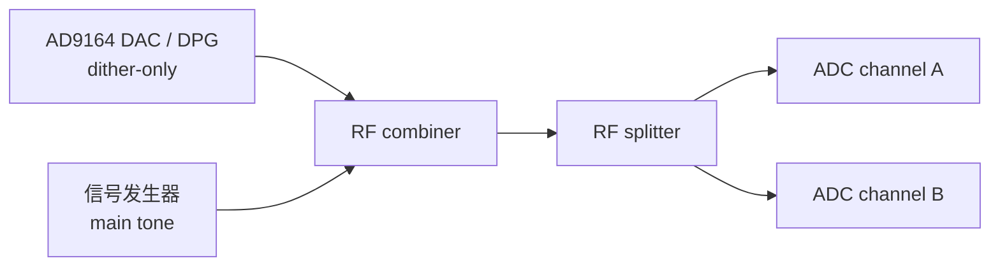

# RF combiner：main tone + dither 手动失配测试

日期：2026-11-18。程序：`firmware/thesis_v3_loop_appl`。

本轮流程：**main tone 与 dither 经 RF combiner 合路 → 同时输入 ADC A/B →
建立基准 → 手动增加一种 mismatch → PRE / TRAIN / HOLD → 查看抵消后波形**。

新版最终输出与三阶段接口已离线测试，尚未完成这次接线下的台架验证。
本文是操作步骤，不是已经通过的测试记录。

## 1. 接线和固定输入



合路后的同一个信号必须送到 A、B。不要给 A 只接 tone、B 只接 dither。
保持 splitter 到两路 ADC 的电缆不动，避免改变相对 skew。

首轮固定以下条件，不在 PRE / TRAIN / HOLD 中途调信号源：

| 项目 | 首轮设置 |
|---|---|
| ADC 采样时钟 | 1.300 GS/s |
| DAC 采样时钟 | 2.600 GS/s |
| FPGA 收发器参考时钟 | 325 MHz，沿用既有 bring-up |
| DAC / DPG | 只播放 dither，不在 DAC 文件里额外合成 main tone |
| Dither 文件 | `waveforms/dither_only/w06adc_e04_t04_amp32767_dither_only_p130.txt` |
| Dither 事件间隔 | 50 ns，即 20 MHz；随机正负极性脉冲 |
| DPG 格式 | Signed、16 bit；Download 后保持 Play |
| 外部 main tone | Sine，199.375 MHz，保持输出开启 |
| Tone 起始幅度 | 先用信号发生器面板 100 mVpp、50 Ω load 设置 |
| ADC IFC | 首轮沿用原设置，建立基准后不改，直到进行 gain 注入 |

这里的 100 mVpp 是仪器面板起点，不是经过 combiner / splitter 后实测的
ADC 输入电压，也不保证新版估计器必定接受。±32767 是 DAC 数字峰值，
不表示 ADC 已达到满量程。检查实际记录中的 clipping。

本轮先不用 100 MHz dither 配置；当前输出抵消器要求稀疏脉冲，
该配置的脉冲占空比不满足现有支持范围。

**仪器频率只设置在信号源上。** 不向固件上传 dither TXT/JSON、参考序列、
极性表或 tone 频率，也不执行 `loop wave` 来选择模板。
TXT 只下载到 DPG。校准与最终抵消都从 ADC 采样获取观测量。

## 2. 固件和串口准备

1. 使用当前工作区源码构建、下载 `thesis_v3_loop_appl`。旧 ELF 不包含
   新增的 HOLD 后输出快照和抵消状态。
2. 完成原有时钟、DAC、JESD bring-up；时钟应在 FPGA/固件启动前稳定。
   完整仪器步骤见 [CALIBRATION_STARTUP.md](CALIBRATION_STARTUP.md) 第 1–5 节。
3. 确认 DPG 的 dither 和外部 main tone 都已开启，再建立基准。
   后续基准和三个单轴测试保持相同的 RF 输入条件。
4. 串口按本机实际端口连接，115200 baud。本文以 COM7 为例。
   每条串口命令完成后再输入下一条，不整段连续发送。

先确认启动日志有 ADC PLL、JESD 接收链路正常的信息，再在串口逐条输入：

```text
adc -c
adc -cal skew step 0
adc -cal loop test status
```

检查时钟状态和 `SKEW-TXN ... result=OK`。记录当前 test config，沿用既有
门限、batch、deadband 和 step 设置，不为了得到 PASS 临时放宽门限。

在 PowerShell 进入仓库，确认运行脚本的 Python 有依赖：

```powershell
Set-Location E:\TIADC
python -c "import serial, numpy, matplotlib; print('Python dependencies OK')"
```

本文 `python` 指装有这些依赖的解释器；若系统命令指向商店占位程序，
改用实际 Python.exe 路径。

## 3. 建立本轮基准，只做一次

关闭占用 COM7 的串口终端。保持 **tone 与 dither 同时开启**，运行：

```powershell
python tools/board_loop/board_loop_log.py --uart COM7 --cmd "adc -cal loop test baseline 600 100" --out calibration_out/combiner_baseline.log
```

这一步是 600 次全部轴训练尝试，再做 100 次全部冻结的 baseline HOLD。
它不是后面的 PRE / TRAIN / HOLD 单轴实验。

完成后重新连接串口，查询：

```text
adc -cal loop test status
```

必须看到 `LOOP-TEST-BASELINE valid=1`。记录以下信息：

| 记录项 | 用途 |
|---|---|
| 基准 `code=N` | 后续 skew 扰动和 restore 的实际起点 |
| `channel=1` 的 `ifc` | B 通道原始 IFC；日志通常打印十进制 |
| `LOOP-TEST-CONFIG` | 本轮固定的门限和控制参数 |
| 路由 | `dither_spectrum` / `dither_cross_spectrum`、`reference_free=1` |
| 输入条件 | tone 频率/幅度、dither 文件、ADC/DAC 时钟、接线 |

例如 `ifc=12` 表示 `0x0C`。N 以本次日志为准，不固定写成 12、24 或 35。

若基准 `valid=0`，先保留 baseline 日志并检查拒绝原因、clipping 和 HOLD
统计，不进入单轴注入。不要把 TRAIN 接近零或 `END result=OK` 单独当成
基准验收通过，也不要反复重跑筛选一次偶然 PASS。

下载新 ELF、重启或更改输入条件后，都需要重新建立基准。

## 4. 每个测试点都是这三个 stage

| Stage | 尝试次数 | 反馈状态 | 要看什么 |
|---|---:|---|---|
| PRE | 40 | 全部冻结，使用基准系数 | 手动 mismatch 是否实际造成初始误差 |
| TRAIN | 300 | 只更新本次选择的轴 | 该轴能否收敛，其他轴是否保持冻结 |
| HOLD | 100 | 全部冻结 | 独立残差、散布、合格率 |

40 / 300 / 100 统计的是**采集尝试**，不是保证合格的帧数。
三个阶段都保持 tone 与 dither 开启，也不改变注入量。

HOLD 完成后，固件再单独采一帧，用同样冻结的校正系数与当前手动注入
学习并抵消 dither。这帧不计入 HOLD 次数/统计，不更新校正系数或执行器。
输出抵消失败不会重新训练或重新评分 HOLD。

## 5. Offset：手动给 B 加 +32 codes

确认有效基准后，在串口逐条执行：

```text
adc -cal loop test restore
adc -cal loop test offset B 32
```

这里是在解帧后的 B 通道、数字校正前加 32 个原生 ADC codes，
属于**软件 offset 注入**，不是 ADC 模拟输入端的已知 DC 电压注入。
RF combiner 的输入保持不变。

关闭串口终端，在 PowerShell 执行：

```powershell
python tools/board_loop/board_loop_log.py --uart COM7 --cmd "adc -cal loop test run offset 40 300 100" --out calibration_out/combiner_offset_p32_r01.log
```

PRE 应出现相应 offset 变化；TRAIN 只更新 offset，gain/skew 保持基准状态。
PRE 中显示的是校正输出 codes，受已有 gain 系数影响，不要求恰好等于 32。

等待脚本完成保存和打开查看器。然后重新连接串口，手动恢复：

```text
adc -cal loop test restore
adc -cal loop test status
```

确认软件注入归零、控制码回到 N，再开始下一项。

## 6. Gain：手动改 B 的 IFC

先读基准的 B IFC。**仅当基准 B 为 `ifc=12`（`0x0C`）时**，使用：

```text
adc -cal loop test restore
adc -cal loop test ifc B 0x0D
```

如果基准已经是 `0x0D`，则选择另一个合法码，例如 `0x0C`，并在文件名
中写明实际转换。不要把写入同一个 IFC 当成增加了 gain mismatch。

关闭串口终端，运行：

```powershell
python tools/board_loop/board_loop_log.py --uart COM7 --cmd "adc -cal loop test run gain 40 300 100" --out calibration_out/combiner_gain_ifc0Cto0D_r01.log
```

PRE 的幅度比应有变化；TRAIN 只更新数字 gain 系数，offset/skew 保持冻结。
`0x0C → 0x0D` 的名义增益变化约为 `1.59/1.70 − 1 = −6.47%`，
实际初始 mismatch 以 PRE 测量为准，不把名义寄存器比例当成测量真值。

脚本结束后重新连接串口，执行：

```text
adc -cal loop test restore
adc -cal loop test status
```

检查 B IFC 回到保存的基准值、软件 offset 为零、控制码回到 N。

## 7. Skew：手动偏移一个控制码

先在串口执行 restore 和 status，确认回到基准 N，再关闭串口。
这次用 PC 发送一条明确的 park 命令完成手动扰动，不运行自动 sweep。

在 PowerShell 输入本轮实际 N，计算一个合法的相邻码：

```powershell
$baselineCode = [int](Read-Host "输入本轮 baseline 的实际 code N")
if ($baselineCode -lt 0 -or $baselineCode -gt 48) { throw "baseline code 必须在 0..48" }
$injectCode = if ($baselineCode -lt 48) { $baselineCode + 1 } else { $baselineCode - 1 }
Write-Host "本次手动 skew 注入: $baselineCode -> $injectCode"
```

明确发送该控制码，记录每次事务 ACK：

```powershell
python tools/board_loop/board_loop_log.py --uart COM7 --cmd "adc -cal loop test park $injectCode" --no-export --no-viewer --out calibration_out/combiner_skew_inject_r01.log
```

确认 `LOOP-SKEW-TXN` 全部 `result=OK`，最后 `code_after` 为所选注入码，
再运行三阶段：

```powershell
python tools/board_loop/board_loop_log.py --uart COM7 --cmd "adc -cal loop test run skew 40 300 100" --out calibration_out/combiner_skew_onecode_r01.log
```

PRE 测实际初始 skew；TRAIN 只允许 skew 执行器通过 ACK 检查的事务动作，
gain/offset 系数冻结；HOLD 全冻结。如果一码扰动已经在 deadband 内，
控制器可能不移动，不能据此认定控制器失效。

先把注入量记录为“一个控制码”，不要直接标成固定的 19.1 ps。
需要 ps/code 时，按 [单项极限测试说明](../../calibration_loop/CALIBRATION_LIMIT_TEST.md)
中的配对步长流程，在当前工作点测 `N → N+1 → N → N+1 → N`。
这是当前观测路线的步长响应，不是独立绝对时基标定。

完成下载后，重新连接串口执行 `adc -cal loop test restore`，并查询 status，
确认回到 N。

## 8. 在查看器里检查两类结果

以 offset 测试为例，默认输出：

```text
calibration_out/combiner_offset_p32_r01/
  combiner_offset_p32_r01.log
  combiner_offset_p32_r01.csv
  combiner_offset_p32_r01.json
  combiner_offset_p32_r01.png
  combiner_offset_p32_r01.svg
  combiner_offset_p32_r01.html
  combiner_offset_p32_r01_signal.csv
  combiner_offset_p32_r01_signal.json
```

有可用输出快照时，PC 自动只读下载，不需要另发普通 `loop 300`。
运行名已存在时会另建带时间后缀的目录，以终端实际打印路径为准。

**先看 PRE / TRAIN / HOLD 曲线与 HOLD assessment：**

- PRE 确实观察到本次注入的误差。
- TRAIN 仅所选轴的系数/控制码变化；其他轴保持冻结。
- HOLD 使用 TRAIN 末态，全部系数和控制码不再变化。
- 默认 PC 判据：HOLD 合格率至少 80%，且所选残差的
  `|均值| + 1.96 × SE` 不超过 offset 0.5 codes、gain 0.1%、skew 10 ps。
  完整性、路由和冻结检查也必须通过。不要用 SD 代替均值偏差。
- 这里的 gain/skew 是当前 dither 频谱路线的相对观测量，
  不把输出单音的主峰比当成 HOLD 评分的替代。

**再切到“输出波形”页：**

- 检查是否明确显示“已抵消 dither”；该标志需要同名 JSON 确认。
- 观察 A/B 时域波形、采样窗口和 A−B。期望保留 main tone 与实际采样噪声。
- 观察输出频谱主峰是否位于信号源设定频率附近。FFT 有有限频点间隔，
  不要求主峰刻度恰好等于 199.375 MHz。
- 这是 HOLD 后保存的**一帧**，不是当前实时波形；restore 后重新打开页面
  仍显示该次保存的数据。普通 UDP 命令仍传原始 DMA 数据。

输出页只有抵消后的数据，不能单凭它宣称“相对抵消前改善了多少 dB”，
也不把拟合后的单音当成独立的真实输入参考。

| 输出状态 | 本轮如何记录 |
|---|---|
| `cancelled` | 两通道通过输出阶段的学习/交叉事件检查；再检查 main tone 是否保留 |
| `no-tone` | 没有可靠识别主 tone；检查 tone 是否开启及实际可辨识程度 |
| `no-dither` | 未检测到可学习的脉冲异常，不能记为抵消成功 |
| `ambiguous` | 当前数据未满足可靠分离条件，保留的校正数据不能标成仅剩 main tone |
| `unavailable` | 最终输出帧不可用；保留已完成的三阶段记录，单独记录输出失败 |
| 缺少 JSON | 状态未确认，不能只凭波形像正弦就记为成功 |

HOLD PASS 与 dither cancellation 是两个独立结果，报告时分别写。
若波形传输失败，脚本会保留校准记录并返回非零；检查原 JSON 的 HOLD
assessment，不把传输失败改写成算法发散，也不要覆盖失败记录。

## 9. 重复测试和结束

先完成 offset、gain、skew 各一个点，再在固定 RF 条件下将各点重复 5 次，
文件名依次使用 r01–r05。每次都手动 restore，再施加同一 mismatch。
记录每次 HOLD 判定和 cancellation 状态，不只挑最好的一遍。

任何阶段出现失败 ACK、`RECOVERY_REQUIRED` 或方向保护锁定，停止本轮，
保留日志，按既有 bring-up 流程处理后重新建立基准，不连续尝试写入恢复。
若 clipping 或持续拒帧，先记录输入条件与原因；更改 tone/dither 条件后
作为新条件重新建基准，不混入原条件的重复结果。

结束时手动 restore 并确认 IFC、软件 offset 和控制码回到本轮基准。
main tone 与 DPG 不会被脚本自动关闭；需要关闭时在保存完结果后手动操作。
