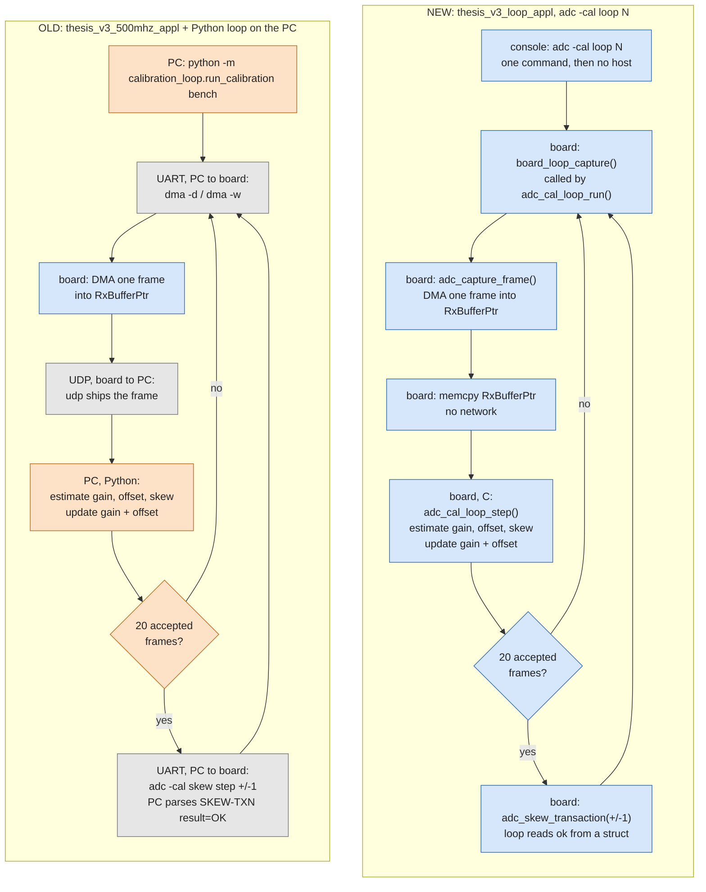
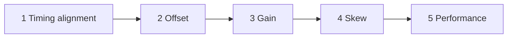
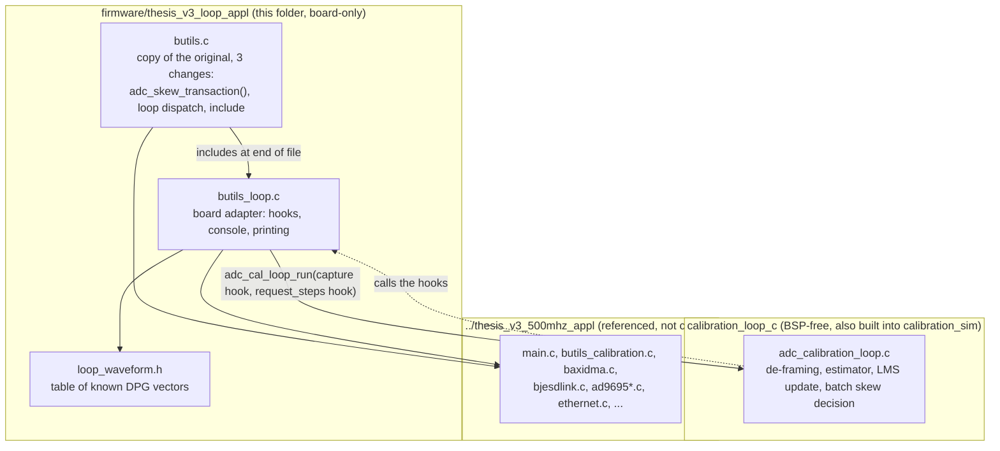
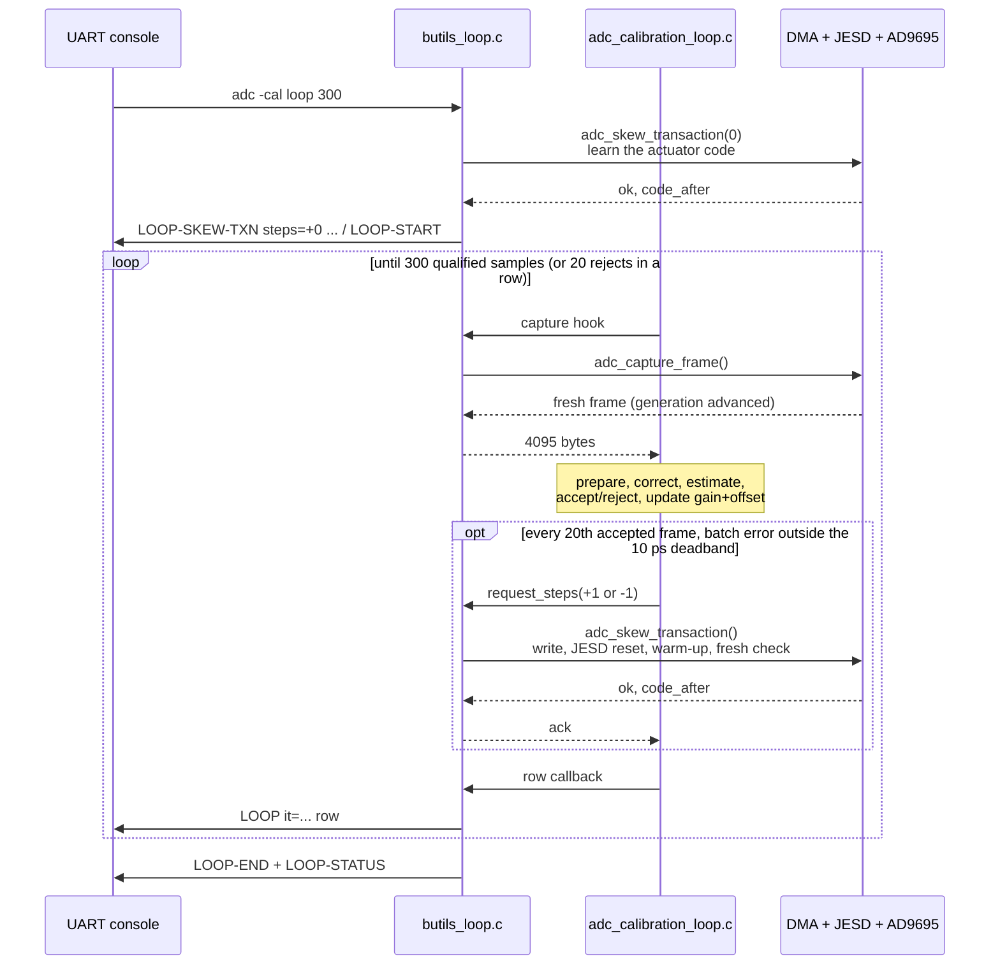
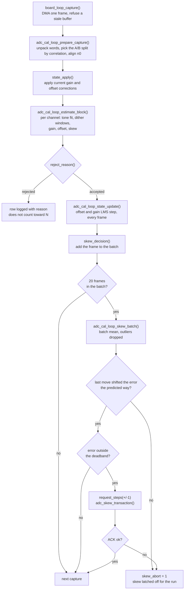

# thesis_v3_loop_appl

The original firmware (`../thesis_v3_500mhz_appl/`) plus one console command,
`adc -cal loop`, which runs the impulse-dither calibration loop **on the
Cortex-A53**. Before this app, the same loop ran only on the host PC
(`calibration_loop/`, Python) and pulled every capture over UDP.

The app keeps every command of the original firmware, including the five-stage
`adc -cal`. Bench-validated 2026-10-14: the closed loop converged at 199.375 MHz
and 399.375 MHz, 300/300 qualified samples each, with every skew transaction
`result=OK` (see [Reference runs](#6-reference-runs-2026-10-14)).

Build details, Vitis traps and the bench checklist are in section 7 of
[`calibration_sim/README.md`](../../calibration_sim/README.md).

---

## 1. Old vs new

The old loop runs on the PC and drives the board one command at a time; the
new loop runs entirely on the board after one command. Orange = PC, blue =
board, grey = a link between them.



Unchanged in both ELFs: `adc -cal`, the five-stage pipeline. It is not a loop
over frames; each stage finishes before the next one starts.



| | `adc -cal` (old, still here) | Python host loop (old) | `adc -cal loop N` (new) |
|---|---|---|---|
| Where it runs | A53 | host PC | A53 |
| Algorithm | five stages in sequence; each stage finishes before the next starts | impulse-dither loop: all axes estimated from every frame | same loop as the Python one, ported to C |
| Gain / offset | one stage each | updated every frame | updated every frame |
| Skew | stage 4 | batch decision every 20 frames, max 1 code per move | same |
| Data path | DMA → firmware | DMA → UDP → PC | DMA → `RxBufferPtr` |
| Skew write | firmware | UART command, PC parses `SKEW-TXN` | `adc_skew_transaction()` returns a struct |
| Rejected frames | — | ~20 %, mostly torn UDP frames | 0 of 300 on the bench (no UDP) |
| Code | `adc_calibration_pipeline.c` + `butils_calibration.c` | `calibration_loop/*.py` | `calibration_loop_c/adc_calibration_loop.c` + `butils_loop.c` |

`calibration_loop_c` reproduces the Python loop. It is checked against it by
`calibration_sim --run-loop-tests` and the `--loop-golden` replay, and on live
data (board `loop open 20` against host `probe`, same state: margin 17.0 / 17.4,
skew +171.6 / +172.0 ps).

---

## 2. Where the code lives



- **Shared sources are referenced, not copied.** `src/UserConfig.cmake` points
  at `../../thesis_v3_500mhz_appl/*.c`, so any change there changes this ELF too.
- **`butils.c` is a copy.** A change to the original `butils.c` must be merged
  here by hand.
- **The loop knows nothing about the board.** It gets frames and moves the skew
  only through two function pointers, so the same file runs in `calibration_sim`.

---

## 3. One run of `adc -cal loop 300`



---

## 4. The important parts of the C code

### 4.1 What happens to each frame



The gain and offset loops keep running after `skew_abort`, because they only
change the digital correction state.

### 4.2 Functions to read, in order

**Board side (this folder)**

| Function | File | What it does |
|---|---|---|
| `handle_adc_loop_cmd()` | [butils_loop.c:280](butils_loop.c#L280) | parses `adc -cal loop N / open N / status / wave K` |
| `board_loop_run()` | [butils_loop.c:203](butils_loop.c#L203) | loads the waveform config, zero-step transaction (closed only), `adc_cal_loop_init()`, `adc_cal_loop_run()`, prints `LOOP-END` |
| `board_loop_capture()` | [butils_loop.c:104](butils_loop.c#L104) | capture hook: `adc_capture_frame()`, checks `dma_capture_generation()` advanced, copies `RxBufferPtr` |
| `board_loop_request_steps()` | [butils_loop.c:130](butils_loop.c#L130) | skew hook: calls `adc_skew_transaction()`, returns its `ok` and `code_after` as the ACK |
| `board_loop_on_row()` | [butils_loop.c:147](butils_loop.c#L147) | row hook: times the compute, prints one `LOOP` line |
| `adc_skew_transaction()` | [butils.c:3402](butils.c#L3402) | the single sanctioned skew write: neutral init if needed → write + readback → warm-up capture → fresh-frame check |
| `loop` dispatch | [butils.c:2910](butils.c#L2910) | `adc -cal loop ...` → `handle_adc_loop_cmd()` |
| include of the adapter | [butils.c:3634](butils.c#L3634) | `#define BUTILS_LOOP_FRAGMENT 1` + `#include "butils_loop.c"` |
| `k_loop_waveforms[]` | [loop_waveform.h](loop_waveform.h) | known DPG vectors: 0 = 199.375 MHz, 1 = 399.375 MHz |

**Loop algorithm (`calibration_loop_c/adc_calibration_loop.c`)**

| Function | Line | What it does |
|---|---|---|
| `adc_cal_loop_run()` | [1656](../../calibration_loop_c/adc_calibration_loop.c#L1656) | outer loop: capture → step until N qualified; stops after 20 rejects in a row or 3 capture failures |
| `adc_cal_loop_step()` | [1591](../../calibration_loop_c/adc_calibration_loop.c#L1591) | one frame, the flowchart above |
| `adc_cal_loop_prepare_capture()` | [569](../../calibration_loop_c/adc_calibration_loop.c#L569) | de-framing and alignment (`n0`, `rotation`, `align_margin`) |
| `adc_cal_loop_estimate_block()` | [976](../../calibration_loop_c/adc_calibration_loop.c#L976) | the estimator: gain, offset, skew for both channels |
| `reject_reason()` | [1548](../../calibration_loop_c/adc_calibration_loop.c#L1548) | acceptance filter: margin < 6, < 2 events, NaN, skew > 0.25 sample, gain off by > 20 % |
| `adc_cal_loop_state_update()` | [1216](../../calibration_loop_c/adc_calibration_loop.c#L1216) | LMS update of `offset_a/b` and `gain_corr_a/b` |
| `skew_decision()` | [1400](../../calibration_loop_c/adc_calibration_loop.c#L1400) | batch, yield check, direction check, deadband, move, ACK |
| `adc_cal_loop_error_to_steps()` | [1277](../../calibration_loop_c/adc_calibration_loop.c#L1277) | error → 0 or ±1 code, respects code limits |

The core of the update, gain/offset every frame:

```c
state->offset_a += mu_offset * e_off_a / gain_corr_a;        /* same for B */
const double mean_g = 0.5 * (ga + gb);                       /* tone amplitudes */
state->gain_corr_a *= 1.0 + mu_gain * (mean_g / ga - 1.0);
state->gain_corr_b *= 1.0 + mu_gain * (mean_g / gb - 1.0);
```

and the skew move, once per batch:

```c
steps = (int)nearbyint(-error_ps / step_ps);   /* clamped to -1..+1, 0 inside the deadband */
loop->act.request_steps(ctx, steps, &ack);     /* -> adc_skew_transaction() */
if (!ack.ok) { skew_abort = 1; }               /* a failed ACK latches skew off */
```

### 4.3 Defaults

| Parameter | Value | Where |
|---|---|---|
| `mu_offset`, `mu_gain` | 0.35 | `adc_cal_loop_default_state()` |
| gain observable | tone ratio | `adc_cal_loop_default_options()` |
| skew batch | 20 frames, min yield 0.4 | `adc_cal_loop_default_options()` |
| direction tolerance | 8 ps | `adc_cal_loop_default_options()` |
| deadband | 10 ps | `adc_cal_loop_default_actuator()` |
| `step_ps` | 19.1 ps/code (only sizes the move; every move is clamped to 1 code) | `adc_cal_loop_default_actuator()` |
| code range | 0..48 | `adc_cal_loop_default_actuator()` |
| min alignment margin | 6.0 | `adc_cal_loop_default_options()` |
| stop after | 20 consecutive rejects | `adc_cal_loop_default_options()` |
| N | 1..2000 | `BOARD_LOOP_MAX_SAMPLES`, `butils_loop.c` |

All of these are compiled in. Changing one means rebuilding the ELF.

---

## 5. Running the loop and recording a log

### 5.1 Console commands

```
adc -cal loop wave [K]   list the known DPG vectors / select K as the one loaded (0 at boot)
adc -cal loop open N     N qualified samples, skew measured only (no actuator writes)
adc -cal loop N          N qualified samples, closed loop (skew moves, ACK-checked)
adc -cal loop status     state of the last run
adc -cal loop [help]     usage
```

### 5.2 Before every run

1. Load this ELF, then do the usual bring-up.
2. Load a tone+dither vector on the DPG. It must be a row of `loop_waveform.h`:
   - `waveforms/tone_dither/w06adc_e04_t04_amp5190_tone_m1p5.txt` → `--wave 0` (199.375 MHz)
   - `waveforms/tone_dither/w06adc_e04_t04_amp5190_tone_m1p5_f399p375.txt` → `--wave 1` (399.375 MHz)

   `waveforms/impulse_dither.txt` and dither-only vectors are **not** supported.
   A wrong vector is not rejected; the results are just wrong.
3. After a firmware reload, initialise the actuator once on the console:
   `adc -cal skew step 0`. Expect `neutral_initialized=YES` and code 24.
4. **Close the serial terminal** (Tera Term, PuTTY, the Vitis serial monitor).
   The logging script needs the COM port to itself.
5. Find the console COM port. On the 2026-10-14 laptop it was `COM7`
   (CP2108 interface 0). Check Device Manager on another PC.

### 5.3 Run with a log

Run from the **repository root**, with `pyserial` installed (`pip install pyserial`):

```powershell
cd C:\Users\Hans\Documents\summer2025_research_tiadc

# quick check, no actuator writes (~20 s)
python tools/board_loop_log.py --uart COM7 --wave 0 --cmd "adc -cal loop open 20" --out calibration_out/closed_loop/open20_w06.log

# full closed loop, 300 samples (~4 min)
python tools/board_loop_log.py --uart COM7 --wave 0 --cmd "adc -cal loop 300" --out calibration_out/closed_loop/run9_board_w06.log

# same at 399.375 MHz (DPG must be playing the f399p375 vector)
python tools/board_loop_log.py --uart COM7 --wave 1 --cmd "adc -cal loop 300" --out calibration_out/closed_loop/run10_board_f399.log
```

What [`tools/board_loop_log.py`](../../tools/board_loop_log.py) does:

1. Opens the port at 115200 baud.
2. With `--wave K`, sends `adc -cal loop wave K` and waits for `LOOP-WAVE`.
3. Sends `--cmd`, prints every console line and writes it to the log.
4. Stops at `LOOP-STATUS` (success), on a firmware `Command Error`, or after
   `--timeout` seconds (default 1800).

Exit code 0 means the run finished. Otherwise the log ends with `# STOPPED: error`
or `# STOPPED: timeout`.

### 5.4 Where the log goes

| Case | Location |
|---|---|
| `--out <path>` given | that path, relative to the directory you ran the command from. Missing folders are created. |
| `--out` omitted | `calibration_out/board_loop_<YYYYMMDD_HHMMSS>.log`, relative to the current directory |
| convention for kept runs | `calibration_out/closed_loop/<stem>.log`, e.g. `run7_board_w06.log` |

Run from the repository root, or the default lands in a `calibration_out/` under
whatever folder you are in. Use a new stem for every run: the script overwrites
an existing file without asking.

The log is plain text. The first lines are `# cmd:`, `# port:`, `# start:` and
`# wave:`, followed by the console output exactly as printed.

### 5.5 Reading the log

```
LOOP-SKEW-TXN steps=+0 result=OK code_after=23 stage=-
LOOP-START mode=closed samples=300 waveform=w06adc_e04_t04_amp5190_tone_m1p5 tone_mhz=199.375 sig_cycles=1276 code=23
LOOP it=0 st=ok n0= rot= margin_x100= tone_ppm= gain_ppm= doff_mc= skew_cps= corr_a_ppm= corr_b_ppm= offa_mc= offb_mc=
...
LOOP it=19 st=ok ... batch=19/20 bmean_cps=17459 act=move:OK-1 code=22
LOOP-SKEW-TXN steps=-1 result=OK code_before=23 code_after=22 stage=-
...
LOOP-END qualified=300/300 captures=300 rejected=0 code=12 skew_abort=0 elapsed_ms=236199 compute_ms_avg=678
LOOP-STATUS mode=closed waveform=... qualified=300 captures=300 rejected=0 polarity=-1 code=12 skew_abort=0 ...
```

`xil_printf` has no floating point, so values are scaled integers, or `nan`.

| Field | Meaning | Converged value |
|---|---|---|
| `st` | `ok` or the reject reason (`margin`, `events`, `a_nan`, `b_nan`, `skew_range`, `gain_range`, `capture`) | `ok` |
| `margin_x100` | alignment margin × 100 | ~1700 for `w06`; much lower means the wrong vector |
| `tone_ppm` | (tone ratio − 1) × 1e6, the controlled gain observable | → 0 |
| `gain_ppm` | (dither g_B/g_A − 1) × 1e6, not controlled | stays at about +12000 by design |
| `doff_mc` | (offset_B − offset_A) × 1000, in codes | → 0 |
| `skew_cps` | skew in 0.01 ps (`-706` = −7.06 ps) | inside ±1000 |
| `corr_*_ppm`, `off*_mc` | applied gain correction − 1 (ppm), offset state × 1000 | settle |
| `batch=u/n bmean_cps act=` | only on a batch decision: frames used, batch mean, action (`move:OK±1`, `inside-deadband`, `abort-direction`, ...) | `inside-deadband` |

Things to check first:

- **`LOOP-START`**: `waveform=` and `tone_mhz=` match the vector on the DPG.
- **`LOOP-END`**: `skew_abort=0`, `qualified=N/N`.
- **Skew transactions**: every `LOOP-SKEW-TXN` has `result=OK`.
- **Actuator code**: `code=-1` in an open run means the actuator was not
  initialised. Run `adc -cal skew step 0`.

---

## 6. Reference runs (2026-10-14)

Both runs: `adc -cal loop 300`, closed loop, tone route, `w06` pulse (edge 4 /
top 4 DAC samples, 5190 LSB), logged with `tools/board_loop_log.py`. The
firmware was reloaded (a new bring-up) between the two runs.

### 6.1 Summary

| | 199.375 MHz | 399.375 MHz |
|---|---|---|
| Log | `calibration_out/closed_loop/run7_board_w06.log` | `calibration_out/closed_loop/run8_board_f399.log` |
| DPG vector / `--wave` | `w06adc_e04_t04_amp5190_tone_m1p5` / 0 | `w06adc_e04_t04_amp5190_tone_m1p5_f399p375` / 1 |
| Start | 2026-10-14 16:14:06 | 2026-10-14 16:38:42 |
| Qualified / captures / rejected | 300 / 300 / 0 | 300 / 300 / 0 |
| Skew moves | 11 × −1, all `result=OK` | 11 × −1, all `result=OK` |
| Code | 23 → 12 | 24 → 13 |
| First batch mean skew | +174.6 ps | +83.5 ps |
| Final batch mean skew | −7.1 ps (held 4 batches) | +5.6 ps (held 4 batches) |
| `skew_abort` | 0 | 0 |
| Skew, last 80 frames | −7.06 ± 0.05 ps (per frame 0.42 ps) | +5.62 ± 0.08 ps (per frame 0.74 ps) |
| Tone ratio B/A, last 80 frames | 0.999973 ± 0.000049 | 0.99989 ± 0.00024 |
| dOffset B−A, last 80 frames | +0.01 ± 0.17 codes | +0.04 ± 0.15 codes |
| Skew scatter, first 20 frames | 14.2 ps | 16.6 ps |
| Final `corr_a` / `corr_b` | +8425 / −6998 ppm | +7429 / +3409 ppm |
| Final `offa` / `offb` | −5.845 / −11.160 codes | −3.056 / −8.285 codes |
| Elapsed / A53 compute per frame | 236.2 s / 0.678 s | 235.4 s / 0.676 s |
| Average step over the run | 16.5 ps/code | 7.1 ps/code |

`±` is the standard error of the mean over the last 80 frames (iterations
220–299); "per frame" is the standard deviation.

### 6.2 Batch decisions, 199.375 MHz (`run7_board_w06.log`)

Columns, per batch of 20 frames:

- **Skew**: the batch mean the decision used, in ps, with the number of frames
  that survived the outlier filter.
- **Gain: tone B/A** and **Offset: B−A**: the residual mismatch, i.e. what the
  estimator still sees *after* the current correction is applied (mean of the
  20 frames' `tone_ppm` and `doff_mc`). Converged = 1.00000 and 0.
- **Gain corr B/A applied** and **Offset B−A learned**: the correction state at
  the end of the batch, `gain_corr_b / gain_corr_a` and `offset_b − offset_a`
  in codes (`corr_*_ppm`, `off*_mc`). These are what the loop has learned about
  the native mismatch; the correction is `(raw − offset) · gain_corr`.

| Batch | Iterations | Skew, batch mean (used) | Gain: tone B/A | Offset: B−A | Gain corr B/A applied | Offset B−A learned | Action | Code after |
|---|---|---|---|---|---|---|---|---|
| 1 | 0–19 | +174.59 ps (19/20) | 1.00190 | −0.64 | 0.98727 | −4.49 | move −1, OK | 22 |
| 2 | 20–39 | +157.68 ps (20/20) | 0.99916 | −0.02 | 0.99336 | −4.55 | move −1, OK | 21 |
| 3 | 40–59 | +146.71 ps (20/20) | 1.00153 | −0.19 | 0.98306 | −5.85 | move −1, OK | 20 |
| 4 | 60–79 | +132.47 ps (20/20) | 1.00061 | +0.30 | 0.97911 | −3.74 | move −1, OK | 19 |
| 5 | 80–99 | +112.68 ps (20/20) | 0.99901 | −0.08 | 0.98601 | −4.31 | move −1, OK | 18 |
| 6 | 100–119 | +94.13 ps (20/20) | 0.99988 | −0.04 | 0.98696 | −4.55 | move −1, OK | 17 |
| 7 | 120–139 | +83.83 ps (19/20) | 1.00088 | +0.04 | 0.98096 | −4.27 | move −1, OK | 16 |
| 8 | 140–159 | +66.19 ps (20/20) | 0.99987 | −0.19 | 0.98191 | −5.58 | move −1, OK | 15 |
| 9 | 160–179 | +49.45 ps (18/20) | 0.99997 | −0.05 | 0.98214 | −6.01 | move −1, OK | 14 |
| 10 | 180–199 | +29.55 ps (20/20) | 0.99994 | −0.03 | 0.98259 | −6.28 | move −1, OK | 13 |
| 11 | 200–219 | +10.93 ps (19/20) | 0.99980 | +0.10 | 0.98396 | −5.57 | move −1, OK | 12 |
| 12 | 220–239 | −7.11 ps (20/20) | 0.99984 | +0.04 | 0.98507 | −5.22 | inside deadband | 12 |
| 13 | 240–259 | −7.12 ps (20/20) | 1.00004 | +0.07 | 0.98477 | −4.81 | inside deadband | 12 |
| 14 | 260–279 | −6.87 ps (20/20) | 0.99998 | −0.23 | 0.98490 | −6.46 | inside deadband | 12 |
| 15 | 280–299 | −7.15 ps (20/20) | 1.00003 | +0.16 | 0.98471 | −5.32 | inside deadband | 12 |

### 6.3 Batch decisions, 399.375 MHz (`run8_board_f399.log`)

| Batch | Iterations | Skew, batch mean (used) | Gain: tone B/A | Offset: B−A | Gain corr B/A applied | Offset B−A learned | Action | Code after |
|---|---|---|---|---|---|---|---|---|
| 1 | 0–19 | +83.51 ps (20/20) | 1.00794 | −0.67 | 0.94906 | −4.85 | move −1, OK | 23 |
| 2 | 20–39 | +78.95 ps (20/20) | 0.99659 | −0.22 | 0.97413 | −6.30 | move −1, OK | 22 |
| 3 | 40–59 | +68.69 ps (17/20) | 1.00280 | +0.09 | 0.95746 | −5.63 | move −1, OK | 21 |
| 4 | 60–79 | +60.56 ps (20/20) | 0.99892 | −0.33 | 0.96588 | −7.91 | move −1, OK | 20 |
| 5 | 80–99 | +53.24 ps (19/20) | 0.99865 | +0.02 | 0.97607 | −7.83 | move −1, OK | 19 |
| 6 | 100–119 | +49.94 ps (20/20) | 1.00230 | +0.05 | 0.96148 | −7.61 | move −1, OK | 18 |
| 7 | 120–139 | +44.29 ps (19/20) | 0.99806 | +0.00 | 0.97538 | −7.39 | move −1, OK | 17 |
| 8 | 140–159 | +32.86 ps (19/20) | 0.99890 | +0.12 | 0.98344 | −6.62 | move −1, OK | 16 |
| 9 | 160–179 | +26.96 ps (20/20) | 0.99963 | −0.12 | 0.98630 | −7.50 | move −1, OK | 15 |
| 10 | 180–199 | +20.33 ps (20/20) | 0.99970 | +0.20 | 0.98856 | −6.13 | move −1, OK | 14 |
| 11 | 200–219 | +12.57 ps (20/20) | 0.99938 | −0.01 | 0.99294 | −6.26 | move −1, OK | 13 |
| 12 | 220–239 | +5.50 ps (20/20) | 0.99927 | +0.08 | 0.99805 | −5.73 | inside deadband | 13 |
| 13 | 240–259 | +5.69 ps (20/20) | 1.00000 | +0.30 | 0.99806 | −3.66 | inside deadband | 13 |
| 14 | 260–279 | +5.73 ps (20/20) | 0.99983 | −0.37 | 0.99925 | −6.26 | inside deadband | 13 |
| 15 | 280–299 | +5.56 ps (20/20) | 1.00047 | +0.15 | 0.99601 | −5.23 | inside deadband | 13 |

### 6.4 Notes

- **300 samples = 15 batches = at most 15 skew moves.** Both runs needed 11 and
  had 80 frames left at the end. If the starting error needs more codes than
  that, run more samples (`adc -cal loop 600`), or park closer first with
  `tools/skew_park.py --verify-frames 0`.
- **Gain and offset converge in the first batch; skew takes eleven.** The
  residual columns are within 0.8 % (gain) and 0.7 codes (offset) of zero from
  batch 1 on, because `mu = 0.35` per frame settles in ~10 frames. The *learned*
  columns keep moving: the offset by about ±1 code from batch to batch (per-frame
  noise ~1.5 codes times `mu`), and at 399 MHz the gain correction followed the
  skew, 0.949 → 0.998 as the skew went +84 → +6 ps. The converged values match
  the native mismatch (gain B/A 1.0154 at 199 MHz and 1.0020 at 399 MHz, offset
  B−A about −4 to −5 codes), so read gain and offset from the last batches.
- **Per-frame scatter shrinks with |skew|.** At 199 MHz the skew scatter fell
  from 14.2 ps to 0.42 ps as the skew went from +175 ps to −7 ps. A noisy
  open-loop reading at large skew does not by itself mean the bench is noisy.
- **399 MHz stopped at +5.6 ps.** One more code (~7 ps at this tone) would
  have reached about −1.5 ps. The 10 ps deadband is wider than the step here;
  a deadband of about half a step would take it. Not changed yet.
- **The two tones agree on the zero, not on the step.** The null interpolates
  to code ~12.4 at 199 MHz and ~12.2 at 399 MHz, but the step is 16.5 against
  7.1 ps/code, i.e. both read ~0.21 rad at code 24. That looks like a constant
  phase rather than a pure delay. Because of the reload between the runs this
  is not yet separated from bring-up drift; the test is `loop open 20` with
  `--wave 0` and `--wave 1` in one bring-up, switching only the DPG vector.
- **The working point depends on the bring-up.** This bring-up nulls near code
  12 (the loop walks down); the September sessions nulled near 35 (walked up).
  Compare runs across bring-ups with that in mind.
